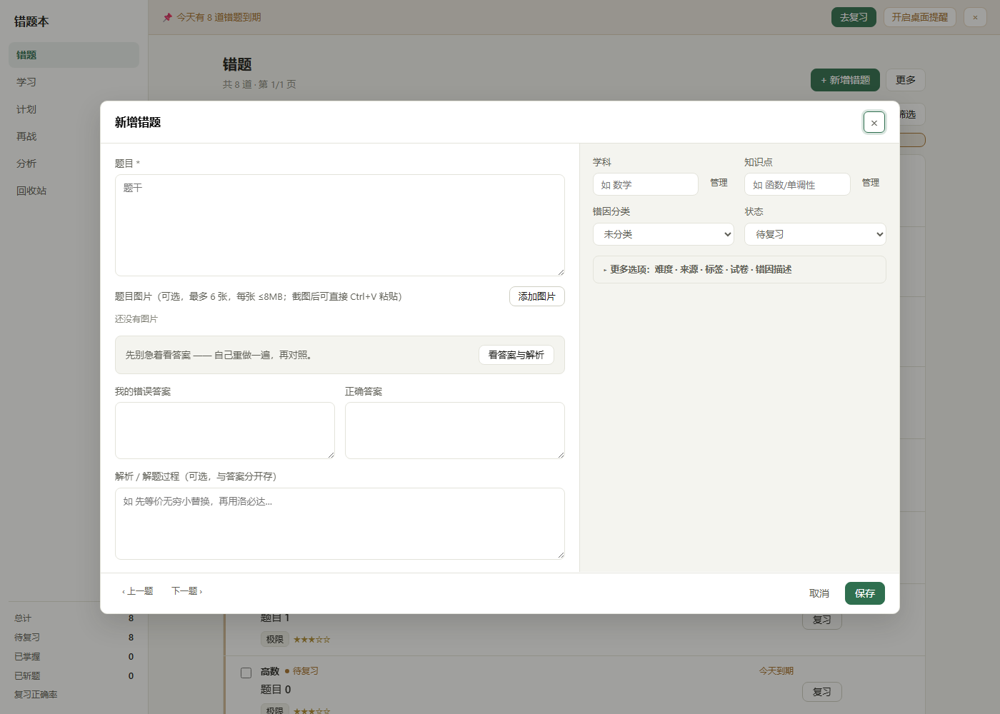
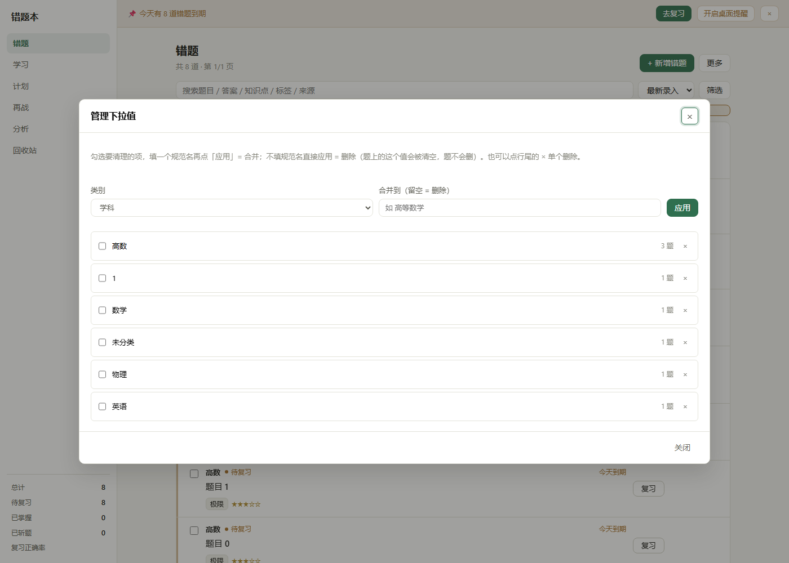

# 错题本 · 版本演进 v0.31–v0.42

> 本文件是[错题本 README](../../README.md)的拆分文档。5.30–5.39。

## 5.30 学习 / 计划 / 分析三页重做（v0.33）

### 5.30.1 为什么要改

这三页 v0.21 之后一直是「数据墙」：进来先看到知识点条数、门禁阈值、七天柱状图、保持度分布、错因条形图，十几个数字铺满两屏，但**看完不知道该做什么**。用户的原话是「错题本的学习，计划，分析好像没用」—— 数据都是对的，缺的是结论和下一步动作。

改法参照 Anki / SuperMemo 这类成熟复习软件的范式：**今天做什么 → 一个开始按钮 → 负载有多大**。落到界面上就是三段式：

1. **结论卡**（`.mb-hero`）：一句人话说清「你现在什么状况」，右边一个主按钮，只此一个。
2. **KPI 排**（`.mb-kpis` / `.mb-kpi`）：4~5 个数字，回答「规模有多大」。
3. **明细**：全部收进 `details.mb-fold`，默认折叠 —— 想深挖的人点开，不想看的人滚不到。

### 5.30.2 三页的新结构

| 页面 | 结论卡说了什么 | 主按钮 | 点了跳哪 |
| --- | --- | --- | --- |
| 学习 | 「今天先补「函数/单调性」」+ 这个点的正确率与到期数（正确率 ≥80% 时改口「「X」已经比较稳」） | 先练「X」· N 道 | 错题页，`knowledge=X` 精确筛选 |
| 计划 | 「今天有 4 道要复习」+「其中 4 道已经逾期」+「按每道 3 分钟粗算，大约 12 分钟」 | 开始今天的 N 道 | 错题页，`due=true` 只看到期 |
| 分析 | 「最该补「Y」」+ 正确率与新增/复习量（没有 <80% 的点时改口「目前没有明显弱项」） | 去练「Y」· N 道 | 错题页，`knowledge=Y` |

三个按钮走的是同一个通道，所以「结论 → 去做」只有一次点击，不会让人在页签之间乱找。

### 5.30.3 面板端改了什么（`dsh-plugin/lib/client.js`）

| 位置 | 改法 | 理由 |
| --- | --- | --- |
| :106-132 CSS | 新增 `.mb-hero` / `.mb-hero-l` / `.mb-hero-t` / `.mb-hero-s`、`.mb-kpis` / `.mb-kpi`、`.mb-krow` / `.mb-krow-l` / `.mb-krow-t` / `.mb-krow-s`、`.mb-fold` / `.mb-foldbody`、`.mb-week` / `.mb-wd` 及柱条 | 三页共用一套骨架，间距与层级只在这里定一次 |
| :1684 `StudyView` | 取数仍是并发四个接口，只是渲染顺序换成「hero → kpis → 知识点行 → 折叠明细」 | 不改取数逻辑，回退风险最小 |
| :1760-1771 hero | `verdict(point)` 生成一句话结论；主按钮文案用 `clip(name, 12)` 截断，按钮不会撑破窄屏 | 长知识点名（如「函数/单调性/含参讨论」）直接把按钮顶到换行 |
| :1773-1778 KPI | 知识点 / 已过门禁 / 今天到期 / 薄弱 / 已牢固 | 「已过门禁」是这套系统独有的概念，得让人看见进度 |
| :1794-1804 知识点行 | 一行一个 `.mb-krow`：名字 + 徽章 + 一句 verdict + 「去练」 | 原来每个知识点是一整张卡，5 个点要滑两屏；现在 5 行一屏看完 |
| :1806 折叠 | 知识点树 / 别名 / 变式缺口收进「整理用」 | 这三样是维护数据时才用的，不该占主视野 |
| :1837 `PlanView` hero | 「今天 N 道 + 逾期 M 道 + 约 X 分钟」（`minutes = max(2, today_count * 3)`） | 给时长估算比给题数更能推动人开始 |
| :1908-1914 七天负载 | `.mb-week` 七根柱，今天那根高亮（`.mb-wd.on`） | 「后天有 20 道」能提前预警，比只看今天有用 |
| :1984 `AnalyticsView` hero | 连续复习天数 / 近 7 天次数 / 环比前 7 天，拼成一句话 | 分析页最容易变成罗列，必须先给判断 |
| :2034-2041 hero 按钮 | 只对 `weak[0]` 给「去练」 | 分析页是「发现」，一个出口就够，多了反而犹豫 |
| :2064-2078 弱项行 | `.mb-krow` + 「正确率 N%」徽章 + 「去练」 | 和分析结论一一对应 |
| :2080 折叠 | 保持度 / 最快会忘 / 错因 / 学科 / 断点 收进「更多数据」 | 默认关闭，需要时再展开 |

### 5.30.4 网页端同步（`static/index.html`）

网页端原来也是同一套数据墙，这一版把面板的三段式搬过去，两端的结论口径必须一致，否则「在网页上看到的」和「在面板里看到的」会打架。

| 位置 | 改法 | 理由 |
| --- | --- | --- |
| CSS | 新增 `.hero` / `.kpis` / `.kpi` / `.krow` / `.fold` / `.foldbody` / `.weekbars` / `.wb`，外加 `max-width:767px` 下主按钮满宽 | 手机上一行放不下「结论 + 按钮」时，按钮独占一行更好点 |
| DOM | `#st-overview` + `#st-note` → `#st-hero` + `#st-kpis`；`#pl-overview` → `#pl-hero`；`#an-overview` → `#an-hero` + `#an-kpis` | 结论与指标是两个区域，分开才好分别控制留白 |
| :1268 `kpi(n, label)` | 一个数字 + 一行标签的 HTML 片段 | 三页复用同一份，避免各写各的样式 |
| :1272 `clipText(text, max)` | 超长截断加省略号 | 主按钮里的知识点名必须限长 |
| :1278 `jumpToList(opts)` | 先设 `#due` / `#knowledge`，**匹配不上就退回 `#q` 全文搜索**，再 `switchView('list')` + `load()` + `renderChips()` | 知识点下拉的选项来自 meta，历史数据里可能有已改名的点，直接 `sel.value=` 赋不进去会静默失败 |
| :1294 `kpVerdict(p)` | 三档人话：<50% 没拿下 / 50~80% 不稳 / ≥80% 已比较稳 | 数字本身不构成判断 |
| :1304 `kpRow(p)` | 一行 `.krow`，按钮带 `data-kp` | 复用事件委托，不用逐行绑 |
| :1321 `loadStudy()` | 只取 `/api/mastery`（不再取 `/api/profile`） | 结论所需的数据 mastery 里都有，少一个请求 |
| :1494 `planRow(it)` / :1505 `loadPlan()` | hero + `.weekbars` 七天负载 + 今天 `.panel` + 后面几天 `details.fold` | 结构和面板一一对应 |
| :1610 `weakRow(p)` / :1632 `loadAnalytics()` | hero + KPI + 「该练什么」panel + 5 个 `details.fold` | 同上 |
| 事件委托 | `#st-hero,#st-list,#an-hero,#an-body` 统一接 `[data-kp]`；`#pl-hero` 接 `#pl-start`；`#pl-list` 从 `.card` 改成 `[data-id]` | 一处委托管三页，新增按钮只要带属性就生效 |

> 面板端对应的是 `pendingListFilter`：`gotoList(patch)` 先把条件存到模块级变量，`ListPane` 下次构建筛选条件时 `Object.assign` 一次然后清空（`client.js:1253` / `:1262` / `:2377`）。**不能直接下载组件里改 `useState`**，那会把 hooks 顺序打乱。

### 5.30.5 验收时发现并修掉的三个真问题

这三个都是「跑起来看着对、其实在骗人」的毛病，靠真实数据 + CDP 实测才暴露出来：

1. **分析页结论说反了**。真实库里 `weak_points[0]` 是「主谓一致，正确率 100%」—— 它排第一是因为错的次数多，不是因为不会。原 hero 直接写「最该补「主谓一致」」，等于让人去补一个已经会了的点。改成遍历找第一个 `accuracy < 0.8` 的；全 ≥80% 时说「目前没有明显弱项 …… 接下来靠间隔复习保持就行」。学习页同理。
2. **`weakRow` 给 100% 正确率也贴「薄弱」徽章**。`band.key` 来自 FSRS 稳定性，和正确率是两回事，混在一起看很困惑。改成 `acc < 80` 才显示 band 徽章。
3. **计划页的行点不开**。`planRow` 输出的是 `.krow`，但事件委托还在找 `.card`，点上去毫无反应。改成 `closest('[data-id]')`。

### 5.30.6 验证

**真实数据几何实测**（Edge headless + CDP，1920×1080 视口，打 `http://127.0.0.1:8000` 的真实库）：

| 视口 | 学习 | 计划 | 分析 |
| --- | --- | --- | --- |
| 1280px | hero「今天先补「111」」kpis 5 块 rows 5 | hero「今天有 4 道要复习 其中 4 道已经逾期…大约 12 分钟」+「开始今天的 4 道」rows 6 folds 1 | hero「目前没有明显弱项 …最常见的错因是「计算失误」」kpis 5 rows 2 folds 5 |
| 420px | hero 高 145、主按钮满宽 362、`.kpi` 宽 125、`.krow` 高 93 | hero 高 145、`.krow` 高 64 | hero 高 117、`.krow` 高 64 |

三页 `overflowX` 全为 `false`（无横向溢出），页面 `console.error` 与未捕获异常均为 0。

**跳转实测**：学习页点「先练「111」· 1 道」→ `#view-list` 显示、`#knowledge=111`、结果 1 条、筛选芯片 1 枚；计划页点「开始今天的 4 道」→ `#due=true`、结果 4 条、芯片 1 枚。

**测试**：`python -m unittest discover -s tests` → **150 passed**（新增 `test_static_three_pages_conclusion_first`：钉住 5 个 hero/kpis 容器存在、3 个旧 `*-overview` 已删除、`jumpToList` / `kpi` / `kpVerdict` / `weakRow` / `planRow` 都在、`class="primary" id="pl-start"` 与 `.weekbars` 存在 —— 防止以后又退回数据墙）；`node --test tests/test_plugin.mjs tests/test_tools.mjs tests/test_client.mjs tests/test_client_render.mjs` → **70 passed**（含 4 个「结论按钮跳转」用例）。

**截图**：`docs/v033-web-{study,plan,an}-{1280,420}.png`，共 6 张。

### 5.30.7 没做的

- 面板的 `PlanView` 还没有七天负载柱状图（网页端有），因为面板侧栏窄，七根柱挤在一起看不出差异。
- 分析页的 KPI 全部从 `/api/analytics` 推导，没有额外取 `/api/stats` —— 多一个接口就多一个失败点，而且会改动 `AnalyticsView` 的 hooks 顺序（渲染测试用固定 seed 跑）。
- 三页都不支持自定义时间窗（分析页固定 7 / 30 / 90 三档）。

## 5.31 知识点分层检索与合并（v0.34）

### 5.31.1 问题：三种乱，一处比一处疼

| 现象 | 疼在哪 | 例子 |
|---|---|---|
| 录入端是自由文本 | 没有任何约束，手一滑就进库了 | 真数据里躺着 `111`、`2` 这种值 |
| 下拉是平铺的原始串 | 看不出谁是谁的子类，也没题数 | `函数`、`函数/单调性`、`函数/二次函数` 三行并列，看着像三个不相干的东西 |
| 检索默认精确匹配 | 点父节点一条都搜不到 | 选 `函数` → 0 条；其实 3 道题的 knowledge 都以 `函数/` 开头 |

第四种乱是隐性成本：`knowledge_tree()`（v0.10）、别名（v0.12）这些机制其实早就写好了，
但网页端从来没有把它们和**筛选**接起来 —— 工具在，路没通。

### 5.31.2 三层修法

**A. 存的时候给台阶**（降低产生脏值的概率）

- 表单的知识点输入框挂 `list="knowledge-list"`，选项来自 `meta.knowledge_flat`（历史值原样，含脏值）。
  这是有意的：补全只提供「你以前写过什么」，不做校验 —— 拦着不让填反而会逼用户瞎归类。
- placeholder 改成「如 函数/单调性（用 / 分层）」，把「斜杠代表层级」这条约定写在用户看得见的地方。

**B. 找的时候分层**（让已有的树变成可用的检索入口）

`meta()` 的 `knowledge` 字段从 `["函数/单调性", "111"]` 升级成 facet：

```json
{"path": "函数/单调性", "name": "单调性", "parent": "函数", "depth": 2, "count": 3}
```

`knowledge_facets(conn, subject="")` 的做法是按 `GROUP BY knowledge` 拿到每个原始值的题数，
再按 `/` 展开出**所有祖先**（`函数/单调性` 同时贡献 `函数` 与 `函数/单调性` 两行，count 累加），
最后按 path 排序返回。返回体里同时给：

| 键 | 用途 |
|---|---|
| `knowledge` | facet 数组，新代码用这个 |
| `knowledge_flat` | 原始字符串数组，老调用方（`datalist`、外部脚本）继续能用 |
| `knowledge_unclassified` | 没填知识点的题数（`knowledge = ''` 且未斩题），给「未归类」入口 |

检索侧 `build_filters()` 一个知识点参数拆成四档：

| 参数 | 语义 | SQL |
|---|---|---|
| `knowledge=X`（默认） | X 及其整棵子树 | `knowledge = ? OR knowledge LIKE ? || '/%'` |
| `knowledge=X&kdeep=0` | 只要精确等于 X | `knowledge = ?` |
| `kq=X` | 包含 X 的任意层级（模糊） | `knowledge LIKE '%' || ? || '%'` |
| `nokp=1` | 只看没填知识点的 | `knowledge = ''` |

**默认改成含子树**是这一版最关键的语义变更：以前 `kdeep` 是「显式开启」，现在反过来。
理由是用户的心里模型 —— 点「函数」就是想看函数下面所有的题；想看单点是小众需求，用 `--exact` 显式要。

**C. 乱的时候能收**（事后清理）

`POST /api/knowledge/merge`，body `{"sources": ["111", "2"], "target": "函数/定义域"}`（也接受 `from` / `to` 两套别名）：

1. 每个 source 走一遍 `SELECT id, knowledge FROM mistakes WHERE knowledge = ? OR knowledge LIKE ? || '/%'` —— **连子树一起搬**。
2. 改写时按后缀拼接：`知识/子类` 的 source 并到 `T` → 子类跟着变成 `T/子类`，层级不塌。
3. 顺手 upsert `knowledge_aliases`（source → target），以后再有人写成旧名字会被 `resolve_knowledge()` 自动纠正。
4. 记一条 `merged` 事件到事件流（`mb.py stream` 可见）。

**拒绝把父并到自己的子**：`函数` → `函数/单调性` 会让路径变成 `函数/单调性/单调性` 这种自指，直接 400。

### 5.31.3 三端入口对照

| 能力 | 网页端 | DSH 面板 | CLI |
|---|---|---|---|
| 分层下拉（缩进 + 题数） | `loadStats()` 渲染 `#knowledge`，全角空格缩进 | `knowledgeFacets()` / `facetLabel()` 喂 `Dropdown` | — |
| 选父含子树 | `query()` 传 `kdeep=1` | filters 初值 `kdeep: true` + 抽屉里的「含子类」勾选框 | `mb.py list --knowledge 函数`（默认子树） |
| 只看未归类 | 下拉里「（未归类 · N 道）」→ `nokp=1` | 同左，chip 显示「未归类」 | `mb.py list --nokp` |
| 模糊找 | — | — | `mb.py list --kq 单调` |
| 精确找 | — | 取消「含子类」 | `mb.py list --knowledge 函数 --exact` |
| 合并清理 | 学习页「合并 / 清理知识点」多选 | — | `mb.py merge 111 2 --to 函数/定义域` |

卡片上的知识点 chip 只显示末段（`单调性`），全路径放 `title` —— 路径长起来会把整行吃掉，
但悬停要能看到它到底挂在哪个父节点下。

### 5.31.4 为什么不做自动聚类

最省事的做法是「编辑距离 < 2 就自动合并」，但知识点不是拼写错误：`函数` 与 `函数值`、`导数` 与 `导数的几何意义`
距离都很近却是不同层级。自动合并一旦合错，改回来要一道道题找。
所以这一版只做**用户显式多选 + 一次确认**，把判断权留在人手里；自动推荐（而不是自动合并）留到以后。

### 5.31.5 验证

| 用例 | 覆盖 |
|---|---|
| `test_mb_list_knowledge_flags` | `--knowledge` 子树=1 / `--exact`=0 / `--kq`=1 / `--nokp`=1 |
| `test_mb_merge_cli` | 合并后题目改写到目标、子树保留 |
| `test_mb_merge_read_only_refused` | `--read-only merge` 退出码 2 且提示 read-only |
| `test_static_knowledge_facets_ui` | 钉住网页端 12 处关键字符串（facet 渲染、`kdeep` / `nokp`、合并面板） |
| `test_knowledge_filter_deep` / `test_knowledge_tree_rolls_up_children` | 既有行为不回退 |
| `test_client_render` 三例 | 分层缩进 + 计数 + 未归类项、老服务字符串数组兼容、chip 文案 |

`node --test` → **73 passed**；`python -m unittest discover -s tests` → **159 passed**。

## 5.32 排序器、学科标签合并与弹窗翻页（v0.35）

### 5.32.1 三件用久了会烦的事

| 现象 | 疼在哪 |
|---|---|
| 列表只能按录入时间倒序 | 昨天刚录的题排最前，真正该先复习的题沉在中间；想找「错得最多的」得自己翻 |
| 学科里有 `1`、`未分类`，标签里有 `4` | v0.34 收好了知识点，这两个字段还是脏的；下拉里一眼看不出哪个是漏填的 |
| 复习完一道要关弹窗、再点下一道 | 连续刷 10 道题就要开关 10 次，中间那步纯属浪费 |

### 5.32.2 A. 排序器：白名单，不拼 SQL

```python
SORT_OPTIONS = {
    "created": "created_at DESC, id DESC",
    "due": ("CASE WHEN next_review_at IS NULL OR next_review_at = '' THEN 1 ELSE 0 END, "
            "next_review_at ASC, id DESC"),
    "stability": ("CASE WHEN fsrs_stability IS NULL OR fsrs_stability <= 0 THEN 1 ELSE 0 END, "
                  "fsrs_stability ASC, review_count DESC, id DESC"),
    "errors": "fsrs_lapses DESC, review_count DESC, id DESC",
}
DEFAULT_SORT = "created"
```

点击 `?sort=` 时走的是 `sort_key = requested if requested in SORT_OPTIONS else DEFAULT_SORT`，
**永远不把 URL 里的字符串拼进 `ORDER BY`**。四档语义：

| 档 | 谁排前面 | 为什么这么排 |
|---|---|---|
| `created`（默认） | 刚录的 | 保持 v0.1 以来的行为，不改变任何人的手感 |
| `due` | 最快到期 | 没排期（`next_review_at` 为空）的整组沉底，否则新题会一直插队 |
| `stability` | 记得最不牢的 | 见下 |
| `errors` | 错得最多的 | `fsrs_lapses` 降序，同分再看复习次数 |

**顺带修掉一个真 bug**：`stability` 原来写的是裸 `fsrs_stability ASC`，
而从未复习过的题 `fsrs_stability = 0`，于是「最不稳定」那一档排第一的全是新题 ——
这一档实际退化成了「最新录入」的同义词。现在先用 `CASE WHEN fsrs_stability <= 0 THEN 1 ELSE 0 END`
把「还没数据」整组推到后面，组内再按稳定性升序。**排序器不该把「没有数据」当成「数据很小」。**

非法档位（手改 URL、老前端、拼错）静默落回 `created`，并把**实际生效**的档回传在
`data.sort` —— 前端拿它回写下拉，才不会显示一个后端没认的选项。

网页端下拉在搜索框右侧（`.sorter{flex:none;width:auto}`，不参与 `.searchbox` 的拉伸）。
排序**只影响顺序**：不进筛选 chips、不参与「重置」，因为它不是筛选条件。

### 5.32.3 B. 学科与标签合并：为什么没复用 `merge_knowledge`

v0.34 的 `merge_knowledge()` 是给知识点写的，它必须处理层级：
把 `知识/子类` 并到 `T` 要拼成 `T/子类`，还要拒绝「父并到自己的子」。
学科和标签是**扁平值**，语义完全不同 —— 学科整列改写，标签是逗号串里换一个词。
硬塞进同一个函数只会让两边都长出一堆 `if kind ==`。所以新开了 `merge_meta(conn, kind, sources, target)`，
用 `kind in ("subject", "tag")` 白名单分派。

`_field_facets(conn, kind)` 给两边都算「值 + 题数」：

```json
{"name": "数学", "count": 3}
```

- `subject`：`SELECT subject AS name, COUNT(*) AS n FROM mistakes GROUP BY subject ORDER BY n DESC, subject`
- `tag`：(`tags` 是逗号串，没有独立表) 遍历 `SELECT tags FROM mistakes WHERE tags <> ''` 拆分计数，
  按 `(-count, name)` 排序 —— 题多的在前，同题数按字典序，顺序稳定。

**标签合并最容易出的错：子串串味。** `tags LIKE '%4%'` 会同时命中 `4` 和 `14`。
所以 `merge_meta` 里是「LIKE 粗筛 + 精确比对」两步：

```python
for row in conn.execute("SELECT id, tags FROM mistakes WHERE tags LIKE ?", ("%" + name + "%",)):
    parts = [t for t in row["tags"].split(",") if t]
    if name not in parts:      # LIKE 是粗筛，这里必须精确确认
        continue
```

`test_meta_merge_tag_is_exact` 钉住了这条：一道题打 `4,14`，合并 `4` 之后 `14` 必须还在。

`meta()` 同时返回 `subject_facets` / `tag_facets`（带题数）与老的 `subjects` / `tags`（裸字符串数组）——
老调用方（`datalist`、外部脚本、CLI 的 `choices`）不用改。

### 5.32.4 C. 弹窗内翻页：本页内翻，不跨页

`state.order` 只记**当前这一页**的 id 顺序（`renderList()` 时写入），`orderPos(id)` 算下标，
`stepItem(delta)` 取相邻项再走一遍 `openEdit(id, mode)`。

为什么只在本页内翻：跨页翻要让后端多吐一页数据、或在前端维护全量顺序，
两个代价都换不来「少点一次」；翻到本页头/尾时按钮置灰，标题写「第 N / M 题（本页）」，
用户能一眼看出边界在哪。

评分条在**翻页后**会重新收起（答案重新遮起来）—— 翻到下一道题本来就该重做，不该带着上一道的答案。

### 5.32.5 三端入口对照

| 能力 | 网页端 | DSH 面板 | CLI |
|---|---|---|---|
| 排序四档 | `#sort` 下拉 | — | `mb.py list --sort due` |
| 合并学科 | 学习页「合并 / 清理」选「学科」 | — | `mb.py meta-merge subject 1 未分类 --to 数学` |
| 合并标签 | 同上选「标签」 | — | `mb.py meta-merge tag 4 --to 极限` |
| 弹窗翻页 | `‹ 上一题 / 下一题 ›` | — | — |

### 5.32.6 验证

| 用例 | 覆盖 |
|---|---|
| `test_list_sort_options` | 四档各自的第一名、非法值回落、`data.sort` 回传 |
| `test_meta_field_facets` | `subject_facets` / `tag_facets` 计数与排序、老字段仍可用 |
| `test_meta_merge_subject` | 学科合并后题目改写、`moved` 计数 |
| `test_meta_merge_tag_is_exact` | `4,14` 场景下合并 `4` 不动 `14` |
| `test_meta_merge_validation` | `kind=knowledge` / 空 sources / 空白 target 三个 400 |
| `test_meta_merge_writes_event` | 合并写 `merged_subject` / `merged_tag` 事件 |
| `test_mb_list_sort_cli` / `test_mb_meta_merge_cli` | CLI 侧同名能力 |
| `test_mb_meta_merge_read_only_refused` | `--read-only meta-merge` 退出码 2 |
| `test_static_v035_ui` | 钉住网页端排序下拉、翻页按钮、合并类型选择的关键字符串 |

`node --test` → **73 passed**；`python -m unittest discover -s tests` → **169 passed**。

## 5.33 把变式题链路接给 agent（v0.36）

### 5.33.1 问题：数据齐了，入口没接

变式题不是新功能。v0.10 就有 `variants` 表、按 `times_used` 轮换的 `pick_variant()`、
按缺口排优先级的 `variant_gaps()`、去重的 `_variant_fingerprint()`，网页端能增删练，
CLI 也能 `mb.py review --variant-question`。**但 DSH 面板里的 8 个工具一条都用不上它。**

| 断点 | 具体表现 |
|---|---|
| 写不进去 | `mb_review` 的请求体只有 `{rating, step}`；后端 `_extract_variant()` 认的三个 `variant_*` 字段，**没有任何 agent 侧代码会发** |
| 看不见库存 | `brief()` 只吐 `#id [学科] 题干（状态）`，而 `LIST_COLUMNS` 早就算了 `variant_count`，白算 |
| 回执丢结果 | `review_mistake()` 在 `app.py:1168` / `:1203` 都做了 `item["variant"] = variant`，插件回执把它丢了 |
| 文档指错路 | `SKILL.md` 三处写 `python mb.py ...`，而面板里 agent 根本没有 shell |

结论：**该优化的不是「再加 AI 能力」，是把已经存在的链路接上。** 自动出题（离线无模型）和
相似度推荐（要引 `rapidfuzz`，破坏零依赖）都没做，理由见 6 节。

### 5.33.2 A. `mb_review` 透传变式：判分 + 入库一次调用

```js
// dsh-plugin/lib/tools.js
parameters.properties = { ..., variant_question: {type:'string'},
  variant_answer: {type:'string'}, variant_knowledge: {type:'string'} }

const vQuestion = String(args.variant_question || '').trim();
if (!vQuestion && (vAnswer || vKnowledge)) {
  throw new Error('variant_answer / variant_knowledge 必须和 variant_question 一起提交');
}
if (vQuestion) { body.variant_question = vQuestion; /* answer / knowledge 同理 */ }
```

**为什么只给答案不给题干要拒绝、而不是静默丢弃**：变式没有题干就是一条废数据，
攒进库只会污染轮换。当场报错比事后从库里捞干净便宜。这条有专门的用例钉住
（断言此时**一个请求都没发**）。

### 5.33.3 B. 回执必须说清「新建」还是「命中去重」

后端去重是按「去掉所有空白后的题干」比对的，所以同一道变式提交两次不会堆记录，
但**会照常计一次练习**。这层语义 agent 看不见就会误判成「没存进去」：

| 服务端回执 | 插件输出 |
|---|---|
| `variant.id` 存在、`duplicate: false` | `已存变式：#41` |
| `variant.id` 存在、`duplicate: true` | `变式已在库中：#41（复用，已计一次练习）` |
| 提交了题干但没有 `variant` | `变式未入库：服务端没有回执（可能已达单题变式上限，或服务端版本过旧）` |

第三行是关键：**宁可报「未入库」也不要静默成功**——agent 会以为补过了，下次还列在缺口里。

### 5.33.4 C. 列表行带变式库存

```js
function brief(item) {
  const variants = typeof item.variant_count === 'number' ? item.variant_count : null;
  const tail = variants === null ? '' : (variants ? ' · 变式 ' + variants : ' · 无变式');
  return '#' + item.id + ' [' + (item.subject || '未分科') + '] '
    + clip(item.question, 60) + '（' + statusLabel(item.status) + tail + '）';
}
```

三种情况分开处理：

- `variant_count > 0` → `· 变式 2`（有库存，可直接抽）
- `variant_count === 0` → `· 无变式`（**这才是该补题的信号**）
- 字段缺失 / 老服务 → 什么都不显示（不瞎猜成 0，否则会把「不知道」误报成「没有」）

### 5.33.5 D. 顺手修掉的真 bug：`mb_add` 不填难度就录不进去

```js
// 改前
difficulty: clampInt(args.difficulty, 0, 0, 5),   // 不传 → 0
// 改后
if (args.difficulty !== undefined && args.difficulty !== null && args.difficulty !== '') {
  body.difficulty = clampInt(args.difficulty, 3, 1, 5);
}
```

服务端 `normalize()`（`app.py:645`）只收 `1 <= difficulty <= 5`，所以 `difficulty: 0`
必然 400「难度必须在 1-5 之间」。**不传就不发这个字段**，让服务端用默认值 3 ——
工具层不该替用户编一个非法默认值。这个 bug 是写端到端冒烟时撞出来的，
不是看代码看出来的（单元测试全程桩掉 fetch，看不到真服务端的校验）。

### 5.33.6 三端入口对照

| 场景 | 面板（agent） | 网页端 | CLI |
|---|---|---|---|
| 看谁该补变式 | `mb_due` 行里的 `无变式` | 卡片上的「变式 N」 | `mb.py list` / `mb.py variant gaps` |
| 抽一道变式 | `mb_get` 后自行判断 | 弹窗变式区 | `mb.py variant next <id>` |
| 判分同时补题 | `mb_review(id, rating, variant_question=...)` | 变式区「＋ 新增」 | `mb.py review <id> --rating X --variant-question ...` |

### 5.33.7 验证

| 用例 | 覆盖 |
|---|---|
| `mb_review 带变式：三个变式字段进请求体，回执报已存 #id` | `assert.deepEqual` 整个请求体，防多塞字段 |
| `mb_review 变式命中去重时回执说复用` | `duplicate: true` 的文案 |
| `mb_review 只给 variant_answer 不给题干时当场拒绝` | 抛错且**0 次请求** |
| `mb_due / mb_search 的行里带变式库存` | 0 / 2 / 缺字段三种尾巴 |
| `mb_add 不传难度时不发 difficulty 字段` | 修回归：以前塞 0 会被 400 拒 |
| `mb_add 传难度时夹到 1-5` | `difficulty: 9` → `5` |

`node --test` → **79 passed**；`python -m unittest discover -s tests` → **169 passed**。

**端到端冒烟**（真服务 + 真工具，`app.py --db tests/_tmp/smoke36.db --port 8811`）：

```
ADD:    已录入 #1 · 高数 · 概念不清 · 下次复习 2026-10-23 19:44:58
DUE:    1. #1 [高数] 求 lim(x→0) sin x / x（待复习 · 无变式）
REVIEW: 已记录 #1 · hard · 断点 计算 | 已存变式：#1
REVIEW2: 已记录 #1 · good | 变式已在库中：#1（复用，已计一次练习）
SEARCH: 1. #1 [高数] 求 lim(x→0) sin x / x（复习中 · 变式 1）
```

补完变式后列表行从「无变式」变成「变式 1」，去重路径也走通了。

## 5.34 复习链路四处漏水（v0.37）

### 5.34.1 问题：规则写着「别给答案」，代码第一时间就把答案递过去了

v0.36 之后变式链路通了，但「让 AI 带我复习」这条主路还是不顺。逐段对照 `SKILL.md` 的规则和插件的实际行为，找到四处：

| 位置 | 规则怎么说 | 代码怎么做 |
|---|---|---|
| 建会话首条消息 | `SKILL.md:118`「出题时不给答案。答案等学生答完再对。」 | `kickoffText()` 直接把 `正确答案` / `解析` 拼进首条消息 |
| 排序 | v0.35 建了四档 `SORT_OPTIONS` | `mb_due` / `mb_search` 一个参数都不传，永远按录入时间 |
| 知识点检索 | v0.34 网页端默认连子树搜 | `mb_search` 只发 `knowledge=`，精确匹配，搜父节点 0 条 |
| 看一道题 | 补变式前得先知道有没有 | `mb_get` 不返回变式，只能从 `mb_due` 行的「变式 N」猜 |

第一条是里面最贵的：**它不是缺功能，是让人设和代码互相拆台**。模型看着眼前的答案被要求「引导学生自己想起来」，很难稳定地忍住不说。

### 5.34.2 A. 首条消息不再注入答案与解析

```js
// dsh-plugin/lib/session.js · kickoffText()
push('题目', item && item.question);
push('我的答案', item && item.my_answer);
// v0.37：正确答案与解析不再塞进首条消息。
push('错因' / '知识点' / '来源' ...);
lines.push('答案和解析我没贴在这里：等我答完，你用 mb_get 取，现在先别告诉我。');
```

**为什么不是「还是贴上，但叮嘱模型别说」**：叮嘱是软约束，先验信息一旦进了上下文就再也拿不出去——模型知道答案以后，它引导的方向、给的提示、选的变式全都会往答案上靠，哪怕一个字都没说出口。**物理上不给，比要求它装不知道可靠。**

代价是模型多一次 `mb_get` 调用。这个代价正是想要的：那次调用发生的时刻，学生已经答完了。

### 5.34.3 B/C. 把 v0.34 / v0.35 建好的能力透给 agent

```js
const SORT_KEYS = ['created', 'due', 'stability', 'errors'];
function sortKey(value) {
  const text = String(value || '').trim().toLowerCase();
  return SORT_KEYS.indexOf(text) >= 0 ? text : '';   // 不认识就返回空串 = 不传
}
```

| 工具 | 新增参数 | 语义 |
|---|---|---|
| `mb_due` | `sort` | 到期题按哪一档排（默认后端 `created`） |
| `mb_search` | `sort` | 同上 |
| `mb_search` | `kdeep` | 默认 `true`，传 `false` 才精确匹配（与网页端 v0.34 对齐） |
| `mb_search` | `nokp` | `true` 只看没填知识点的（对应网页端「（未归类 · N 道）」） |

两个细节：

- **`kdeep` 只在给了 `knowledge` 时才发**：`kdeep: args.kdeep === false ? 0 : (args.knowledge ? 1 : '')`。没有知识点还发 `kdeep=1` 是无意义的噪声，服务端也会多走一遍分支。
- **白名单校验放在工具层**：拼错的 `sort` 不往后端发，让服务端用默认档，而不是让一个错值穿过网络再去后端兜底。这与 v0.35 后端「非法值落回 `created` 并回传实际档」是两层不同的防护。

### 5.34.4 D. `mb_get` 列出已有变式

```js
let variantRows = [];
try {
  const data = await call(s, '/api/mistakes/' + id + '/variants');
  variantRows = data && Array.isArray(data.items) ? data.items : [];
} catch {
  variantRows = [];            // 老服务没这接口：跳过，不打断主流程
}
```

**为什么 `catch` 吞掉而不是抛**：变式列表是附属信息，主任务是「读这道题」。服务端版本旧一点就不该让一次复习开不了头——降级成「暂无」比整个工具报错好。

输出两种形态：

```
已有变式（2 条）：
  #1 求 lim(x→0) tan 2x / x · 练过 1 次
  #2 求 lim(x→0) sin 5x / x · 练过 1 次
```
```
已有变式：暂无（可以现场出一道同知识点的新题，用 mb_review 的 variant_question 存下来）
```

第二行把「该干什么」直接写在缺少的那一格上——比空着让模型自己想去推断便宜。

### 5.34.5 三端入口对照

| 场景 | 面板（agent） | 网页端 | CLI |
|---|---|---|---|
| 按最该复习的排序 | `mb_due(sort="due")` | 搜索框右边「最新录入 ▾」 | `mb.py list --sort due` |
| 按父知识点搜全部子树 | `mb_search(knowledge="函数")`（默认含子树） | 知识点下拉选父节点（默认 `kdeep=1`） | `mb.py list --knowledge 函数` |
| 只看没归类的 | `mb_search(nokp=true)` | 下拉「（未归类 · N 道）」 | `mb.py list --nokp` |
| 看这道题攒过哪些变式 | `mb_get(id)` 的「已有变式」段 | 弹窗变式区 | `mb.py variant next <id>` |

### 5.34.6 验证

| 用例 | 覆盖 |
|---|---|
| `首条消息不泄题：答案与解析都不注入，只留一句「答完再取」` | 用「机密答案」/「机密解析」当哨兵，断言两者**都不出现** |
| `首条消息：空字段整行省略…`（改） | 原来断言 `/正确答案：a/`，v0.37 起改为断言不出现 |
| `mb_due 透传 sort；非法值不往后端发` | `sort=errors` 出现在 URL；`sort=瞎写` 时 URL 里**没有** `sort=` |
| `mb_search：知识点默认含子树，nokp 查未归类，sort 透传` | `kdeep=1`（默认）/ `kdeep=0`（显式 false）/ `nokp=1` / `sort=stability` |
| `mb_get 列出已有变式，没有就说暂无` | 两条变式 + 练过次数 |
| `mb_get：老服务没有变式接口时不炸` | 404 降级成「已有变式：暂无」，题目照常输出 |

`node --test` → **84 passed**；`python -m unittest discover -s tests` → **169 passed**。

**端到端冒烟**（真服务 + 真工具，`app.py --db tests/_tmp/smoke37.db --port 8813`）：

```
ADD:  已录入 #1 · 高数 · 概念不清 · 下次复习 2026-10-23 20:04:47
GET:  #1 [高数] 复习中
      题目：求 lim(x→0) sin 3x / 2x
      正确答案：3/2
      分类：概念不清 · 知识点 函数/极限 · 标签 无 · 难度 3 · 来源 无
      已有变式（2 条）：
        #1 求 lim(x→0) tan 2x / x · 练过 1 次
        #2 求 lim(x→0) sin 5x / x · 练过 1 次
SEARCH(函数,含子树): 共 1 道：1. #1 [高数] 求 lim(x→0) sin 3x / 2x（复习中 · 变式 2）
SEARCH(函数,精确):   没有匹配的错题。
```

同一道题，**含子树搜得到、精确搜不到**——这正是 v0.34 在网页端定下的语义，现在面板侧一致了。

## 5.35 AI 功能修复：把「别先看答案」变成机制（v0.38）

### 5.35.1 问题：三条规则和实现互相拆台

| 位置 | 写着什么 | 实际行为 |
| --- | --- | --- |
| `dsh-plugin/skills/review/SKILL.md:18` | 「拿到题号后用 `mb_get` 读全文——**必须先看正确答案与解析**」 | 与 v0.37「首条消息不泄题」完全相反，等于让学生还没开口，答案就进了上下文 |
| 同文件第 3 步 | 「变式题由你现场出，**不写进错题本**」 | 与 v0.36 的变式入库链路（`mb_review` 的 `variant_question`）相反，新功能等于没人用 |
| 同文件第 4 步 | 判分表四档 | 没有 `step` 断点，也没提 `mb_weak_steps` / `mb_events`（v0.22 起就有） |
| `dsh-plugin/lib/tools.js` 的 `mb_get` | —— | 不论什么场景都把 `正确答案：` / `解析：` 吐出来，没有开关 |

根因一句话：**规则是靠叮嘱的，机制上没有任何阻断**。v0.37 只在「建会话首条消息」这一个人口堵了，`mb_get` 是第二个、也是更常用的入口；而面板预设挂的技能文件从 v0.22 起就没再同步过，落后 15 个版本。

### 5.35.2 改法 A：`mb_get` 默认不泄题

```js
// dsh-plugin/lib/tools.js · mb_get
const reveal = args.reveal === true;
if (reveal) {
  if (oneLine(item.answer)) lines.push('正确答案：' + oneLine(item.answer));
  if (oneLine(item.analysis)) lines.push('解析：' + oneLine(item.analysis));
} else if (oneLine(item.answer) || oneLine(item.analysis)) {
  lines.push('答案与解析：已隐藏（学生答完后 mb_get(id, reveal: true) 再看）');
}
```

- 默认值选 `false` 而不是加一个 `hide_answer` 参数：默认值是唯一不会被忘记传的参数。
- 题干、**学生自己的错答**（`my_answer`）、错因、分类照给 —— 这些是「对着讲」的素材，不是答案。
- 题库里本来就没填答案/解析时**不写那行提示**，免得凭空多出一句废话（见 5.35.5 的第二个用例）。
- 判分环节仍然看得到解析：`mb_get(id, reveal: true)`。这是整轮复习里唯一该看答案的地方。

### 5.35.3 改法 B：面板复习技能重写

`dsh-plugin/skills/review/SKILL.md`（1324 → 4098 字节）从四步改成五步，与 `README.md` / `~/.dsh/skills/mistake-book-ai-tutor/SKILL.md` 口径对齐：

| 步骤 | 改动 |
| --- | --- |
| 1 取题 | `mb_due` 补 `sort`；`mb_search` 补 `kdeep`（默认含子树）/ `nokp`（只看未归类）；新增「我总在哪一步错」→ `mb_weak_steps`、「流水账」→ `mb_events` |
| 2 读题 | 新增，明确「`mb_get` 默认不给答案」与「学生答完之前不要传 `reveal: true`」，并交代顺带看「已有变式」别重复出题 |
| 3 让学生先作答 | 原第 2 步，措辞从「讲思路」改成「重做一遍」 |
| 4 出变式并入库 | 原第 3 步的「不写进错题本」删掉，改为「连同 `variant_question` 交给 `mb_review`，去重自动做」 |
| 5 判分并回写 | 补 `step` 六档与判定口径（式子对但算错→计算、看错条件→审题、思路搭不起来→建模、答案对但写不出过程→表达、会做但记不住公式→记忆、算完没检查→检验），并写明「判断不出来就别填，瞎填比不填更糟」 |

同一份 `cordis.patch.yml` 里复习预设的 persona 也同步改了（144 → 226 字），把「不写讲义、一题一题来」之外补上「答完之前不要看答案（`mb_get` 默认不给，判分时才传 `reveal: true`）」和「变式用 `variant_question` 存进库」。

### 5.35.4 改法 C：答疑预设显式 reveal

`dsh-plugin/skills/qa/SKILL.md`（659 → 1763 字节）只改一处：读题从 `mb_get` 改成 `mb_get(id, reveal: true)`，并加一句「答疑本来就要看答案，所以显式传；复习模式默认是不给答案的」。

为什么是两份技能而不是一个开关：**答疑与复习对答案的需求正好相反**。答疑的产出是「你错在哪」，不看答案根本判不了对错；复习的产出是「你自己想出来」，先看答案就废了。所以差异放在预设层（各自挂自己的技能目录），而不是在工具里加场景判断。

### 5.35.5 验证

| 用例 | 断言 |
| --- | --- |
| `mb_get 默认不给答案与解析，reveal: true 才给（v0.38）` | 默认输出不含「机密答案」「机密解析」，含「答案与解析：已隐藏」与「reveal: true」；同时**照给**「题目：」「我的答案：」；传 reveal 后两行答案出现且无「已隐藏」 |
| `mb_get：题面本来就没填答案时，不写那行「已隐藏」` | 空答案的空题，输出里没有「已隐藏」 |
| 原有 `mb_get 列出已有变式` / `老服务没有变式接口时不炸` | 保持通过（答案隐藏不影响变式段与历史段） |

- `node --test tests/test_tools.mjs` → **20 passed**（新增 2 条）。
- `node --test tests/test_plugin.mjs tests/test_tools.mjs tests/test_client.mjs tests/test_client_render.mjs` → **86 passed / 0 failed**。
- `python -m unittest discover -s tests` → **169 passed**（本版没动 Python 侧）。
- `node --check dsh-plugin/lib/tools.js` 通过；`cordis.patch.yml` 用 `yaml.safe_load` 解析仍为 2 个 insert 块。

### 5.35.6 生效方式

- `mb_get` 的行为改在 `dsh-plugin/lib/tools.js`：DSH 按 mtime 重算插件产物，**刷新页面即生效**，不用重启。
- 技能文件与 persona 是**会话启动时**读的：已经开着的复习会话不会中途换脑子，要**新开一个「错题复习」会话**才看得到新规则。
- `~/.dsh/skills/mistake-book-ai-tutor/SKILL.md`（git 之外的全局技能）本版不动，它讲的是 CLI 那条链路。

## 5.36 录入弹窗瘦身与下拉值可删（v0.39）

### 5.36.1 问题：右栏是一条长龙，脏值只能并不能删

截图里的右栏从上到下是 9 个字段，全部同权重竖着排：

| 行 | 字段 | 实际使用频率 |
| --- | --- | --- |
| 1 | 学科 / 难度 | 学科必填，难度多数人不填 |
| 2 | 错因分类 / 来源 | 错因有用，来源偶尔 |
| 3 | 知识点 / 标签 | 知识点必填，标签很少 |
| 4 | 试卷 | 偶尔 |
| 5 | 状态 | 默认值就够 |
| 6 | 错因详细描述 | 偶尔 |

两个后果：一是**每次录入都要扫过一堆用不到的字段**；二是 `错因分类` 和 `错因详细描述` 被隔开三行，明明是一对却看着像两件事。

另一个问题更实际：v0.34 给了「合并 / 清理」面板，但它是**只能并、不能删**。想清掉学科里的「1」，只能先造一个规范名（比如「数学」）再把「1」并过去——如果这条脏值本来就不该有值，你被迫给题安一个假名字。

### 5.36.2 改法 A：右栏分两层，高频在前

```html
<div class="grid2">
  <label>学科
    <span class="row-inline">
      <input id="f-subject" list="subject-list" placeholder="如 数学">
      <button type="button" class="ghost mini" data-facets="subject" title="管理学科下拉">管理</button>
    </span>
  </label>
  <label>知识点 …</label>
</div>
<div class="grid2"><label>错因分类…</label><label>状态…</label></div>
<details class="fold moreopts">
  <summary>更多选项：难度 · 来源 · 标签 · 试卷 · 错因描述</summary>
  …五个低频字段…
</details>
```

- 折叠用原生 `<details>`，不写 JS：默认收起、点标题展开、无状态要维护，浏览器还自带键盘可达性。
- 只挪位置不改 id —— 所有 `$('#f-difficulty')` 之类的取值代码一行没动，折叠起来照样能读到值（`value` 与是否可见无关）。
- 「更多选项」的标题把五个字段名都列出来，是为了**收起时也知道里面有什么**，不用点开找。

### 5.36.3 改法 B：`target` 传空串 = 删除

没有新增接口。合并接口本来就是这个语义：把若干源值改写成一个目标值。删除只是「目标值为空」这一个特例：

```python
# app.py · merge_knowledge
clearing = not (target or "").strip()
target = resolve_knowledge(conn, target or "")
if not target and not clearing:
    raise ValidationError("目标知识点不能为空")
```

三个容易写错的地方：

1. **不能登记别名**。合并时会写一条 `alias -> canonical`，让以后手写的旧名自动归到规范名；删除时如果也写，别名就指向空串，**以后正常录入这个知识点会被悄悄清空**。所以 `if not clearing:` 才写别名。
2. **标签要跳过空值**。标签是逗号串，删除一个标签时不能往 `tags` 里塞空串（会变成 `极限,,14`）。
3. **学科清空是合法状态**，不是错误 —— 它对应「未分类」。所以 `_field_facets()` 的 subject 分支加了 `WHERE subject <> ''`，否则下拉里会出现一个名字为空的选项，还越攒越多。

### 5.36.4 改法 C：管理面板

| 操作 | 交互 | 请求 |
| --- | --- | --- |
| 合并 | 勾选 N 项 + 填「合并到」+ 应用 | `POST /api/meta/merge` 或 `/api/knowledge/merge`，`target` 有值 |
| 批量删除 | 勾选 N 项 + 「合并到」留空 + 应用 | 同上，`target: ""` |
| 单个删除 | 点行尾 × | 同上，`sources: [这一项]`, `target: ""` |

- 三种操作共用一个接口和一段渲染代码，面板里只按「有没有 target」分叉。
- 删除前弹 `confirm` 并写清「题上的值会被清空，题本身不会删」——这是这个面板唯一会造成不可逆改动的操作，值得多一次点击。
- 勾选项里包含「合并到」填的那个名字时直接拦住：把 A 并到 A 是空操作，多半是选错了。

### 5.36.5 验证

| 用例 | 断言 |
| --- | --- |
| `test_knowledge_merge_empty_target_clears` | 目标留空返回 200 且 `cleared=true`，题的 `knowledge` 变空串；之后正常录入同一个知识点**不会**被清空（证明没登记别名） |
| `test_meta_merge_empty_target_clears` | 学科清空后 `subject == ''`；标签清空只摘掉那一个（`14,极限` → `极限`） |
| 原有 `test_knowledge_merge_rejects_empty` / `test_meta_merge_validation` | 仍断言「sources 为空」报 400；原来那条「target 为空报 400」随语义一起改掉 |

- `python -m unittest discover -s tests` → **171 passed**（+2）。
- `node --check` 抽取的内联脚本通过（弹窗与面板全部改在 `static/index.html`）。
- 顺手修掉一个**定时炸弹测试**：`tests/test_client_render.mjs` 的 `ITEM.next_review_at` 原来写死 `2026-10-23 10:00:00`，而到期徽标是拿「今天」比的 —— 到 10 月 24 日这条用例自己就红了（期望「今天到期」、实际「逾期 1 天」）。改成按运行当天生成，`86 passed`。
- 真服务 + Edge headless 截图复核：录入弹窗右栏为「学科|知识点 / 错因|状态 / 更多选项（收起）」，管理面板列表项为「勾选框 + 名称 + N 题 + ×」。

### 5.36.6 效果





### 5.36.7 一个没做的事

没做「学科下拉里直接删除」。原生 `datalist` 的选项不可点、不可改，要删只能另开一个面板；把下拉换成自绘的 combobox 能少一次点击，但会失去原生输入法/键盘行为，对一个录入频率不高的表单不划算。
## 5.37 把插件做成标准 DSH bundle（v0.40）

v0.21 起，错题本插件是靠两条手工步骤挂在 profile 上的：`mklink /J` 建目录联接、把 `cordis.patch.yml` 里的 `- insert:` 块手抄进 profile 的 patch 文件。两步都只在本机成立，别人 clone 下来照做装不上，还埋了一个看起来像「插件被删了」的坑。

### 5.37.1 症状与根因

现象：DSH 插件管理里看不到 `dsh-mistake-book`，侧栏没有「错题」入口，但 `~/.dsh/profiles/desktop/cordis.patch.yml` 里的注册行完好无损。

两条根因，缺一不可：

- **插件管理只认 bundle**：`@deepseek-ai/dsh-app-boot` 的 `readProfilePlugins(location)` 判断一个包能不能被界面管理，条件是 `bundleManifest(location, name)?.dsh?.bundle?.patch !== void 0`。也就是必须**同时**满足「在 profile `package.json` 的 `dependencies` 里」和「自己 `package.json` 里有 `dsh.bundle.patch`」。错题本两条都不满足 —— 它只是 profile patch 里的一行 insert，界面根本不认识它。
- **junction 形态的包读不到**：profile 的 `node_modules` 下，`dsh-mistake-book` 是目录联接，而同目录的 `dsh-search-enhance` / `dsh-vision-router` / `dsh-sidebar-plus` / `dsh-whale-widget` / `dsh-font-adjust` / `dsh-cost-meter` / `billion-context` / `@linxin666/dsh-client-ui-git-graph` 八个**全是真实目录**。`dsh-search-enhance` 的 README 里也专门写了这条：pnpm 对本地路径一律建 junction，结果是装上但界面里看不见。

### 5.37.2 改了什么

| 文件 | 改动 |
|---|---|
| `dsh-plugin/package.json` | 去掉 `private`；加 `dsh.bundle.patch`、`icon`、`files`、`engines`、`keywords`、`license`、`repository`/`bugs`/`homepage` |
| `dsh-plugin/install.mjs` | 新增。真副本安装 + 登记 `dependencies` 与 `dsh.profile.bundles` + 替换 `<REPO>` 占位符 |
| `dsh-plugin/README.md`、`LICENSE`、`icon.png` | 新增（图标由 `tools/make_icon.py` 用 Pillow 4× 超采样生成，256×256） |
| `dsh-plugin/cordis.patch.yml` | `customSkillDirs` 单引号改双引号；头部注释改成 `node install.mjs` |
| profile 的 `cordis.patch.yml` | **删掉** 3 个重复 insert 块 |

四个关键点：

- **为什么必须删 profile 那份**：`readProfilePatches()` 的顺序是 `[...readBundlePatches(...), ...profile 自己的 patch, ...]`，两层**叠加**不是覆盖。同一个 id 写两遍 = insert 两次，启动直接报重复 id。
- **为什么 `customSkillDirs` 要改成双引号**：路径里有用户名 `sh'w`，YAML 单引号标量碰到撇号会提前结束，解析抛 `ParserError: while parsing a block collection ... expected <block end>, but found '<scalar>'`。这是真踩过的，首次安装后整个 patch 解析失败。
- **为什么逐文件拷而不用 `cpSync`**：DSH 开着时目标目录里可能有文件被占用，逐文件拷能报出是哪个文件，整目录拷只会一个 EPIPE 什么都不说。
- **为什么 `<REPO>` 在安装时替换**：预设里的 `customSkillDirs` 必须是绝对路径（DSH 会话的工作目录是任意的），而仓库可能 clone 在任何地方。

### 5.37.3 安装

```bash
cd mistake-book/dsh-plugin
node install.mjs --check   # 只看会改什么，不写盘
node install.mjs           # 真装（幂等，重复跑没事）
node install.mjs --uninstall
```

装完**重启 DSH 桌面端**（不是刷新页面 —— 补丁在启动时读，没有热重载）。之后：

- 插件管理里能看到「错题本」，可以自主开关；
- `dsh.profile.bundles` 里有 `dsh-mistake-book`，卸载重装不会丢；
- profile 的 `cordis.patch.yml` 里**不需要**再有错题本的任何 insert 块。

### 5.37.4 验证

| 项 | 结果 |
|---|---|
| 安装形态 | `lstatSync(dest).isSymbolicLink() === false`，真实目录 |
| 拷贝内容 | `cordis.patch.yml` / `icon.png` / `lib`（6 个 js）/ `LICENSE` / `package.json` / `README.md` / `skills`（review + qa） |
| `<REPO>` 残留 | 功能性残留 0 处（只剩注释里的说明文字） |
| 重复 id | profile patch 的 insert ids = `[]`，bundle patch = 3 个，无交集 |
| node 测试 | `node --test tests/test_plugin.mjs tests/test_tools.mjs tests/test_client.mjs tests/test_client_render.mjs` → **86 / 86** |
| python 测试 | `python -m unittest discover -s tests` → **171 / 171** |

## 5.38 AI 工具面扩展：批量写、组卷、复盘、知识库整理（v0.41）

### 5.38.1 问题：AI 只有一只右手

v0.21 到 v0.40，工具面一直是 8 个，而且**读的多、写的只有两件**：`mb_add` 新增一道、`mb_review` 判一道。这带来四种绕远路：

| 用户想做的事 | 当时 agent 只能 |
|---|---|
| 一次录入 20 道题 | 调 20 次 `mb_add`，20 个往返，模型还得自己数录到第几道 |
| 「给我出一张卷子」 | 组卷打印 v0.8 就有了，但 agent 够不着，只能自己拼文字 |
| 「这周学得怎么样」 | `mb_stats` 给的是库存快照（没有时间窗口），想算周报得自己拉五个接口 |
| 「知识点太乱帮我收一下」 | 合并接口 v0.34 就有，但 agent 看不见**有哪些值**、哪些该合 |

### 5.38.2 五个新工具（8 → 13）

| 工具 | 参数 | 打哪个端点 |
|---|---|---|
| `mb_batch` | `text`（`---` 分块，块内 `键: 值`）/ `items`（数组）/ `preview`（**默认 true**） | `POST /api/mistakes/batch` |
| `mb_paper` | `count`(10，1-100) `order`(weak/random/recent/oldest) `mode`(question/answer/split) `title` + 学科/知识点/错因/标签/状态/到期筛选 `images` `analysis` `blank` | `/api/paper`，回执里给 `/print?...` 链接 |
| `mb_report` | `days`(7，1-90) | `Promise.all` 拉 `/api/stats` + `/analytics` + `/mastery` + `/plan` + `/arena` |
| `mb_suggest` | `kind`(knowledge/subject/tag) `limit`(20) | `/api/meta`（**纯读，不改库**） |
| `mb_merge` | `kind` `sources`（数组，必填）`target`（**留空 = 删除该值**） | `POST /api/knowledge/merge` 或 `POST /api/meta/merge` |

五个工具都返回**给模型读的纯文本**，不是 JSON，和原有 8 个同一口径。

### 5.38.3 三个设计决定

- **批量导入默认只预览（`preview` 默认 `true`）**。写库不可逆，而模型对「这道题到哪结束」的判断并不可靠 —— 一道长题里有个空行、或者题干自带一行 `---`，就会被切成两道。所以先回显「共 N 道 + 各道标题」，让模型（和用户）看一眼，再要一次 `preview:false` 才真写。预览走本地粗解析（不请求后端），真正的校验仍然在服务端 `parse_batch_text` 里。
- **组卷返回链接，不返回 PDF 字节**。`/print` 是服务端渲染的 A4 页，纸张、边距、缩放要靠浏览器 Ctrl+P 里选，agent 生成 PDF 反而丢掉这些。返回一个 URL，用户点开就能印。
- **建议与执行分成两个工具**（`mb_suggest` / `mb_merge`）。suggest 纯读、幂等；merge 改库、不可逆。分开之后「先看再改」是调用顺序上的强制，不是提示词里的叮嘱 —— 和 v0.38 把 `mb_get` 的答案藏起来是同一个思路。

### 5.38.4 相似度：为什么不能只看「包含」

`foldName()` 把层级分隔符统一（空格 / `>` / `·` / `・` 都当 `/`）再小写；`similarName()` 三条规则：

1. 归一化后**完全相同但原文不同** → 1.00（这类最该合：`函数 单调性` vs `函数/单调性`）；
2. **父子关系**（`fa` 以 `fb + "/"` 开头）→ 0（`函数` 与 `函数/极限` 是层级，不是重复）；
3. 其余按编辑距离 `1 - dist / 最长长度`，`>= 0.72` 才报。

第 2 条是踩坑补的：第一版没排除父子关系，冒烟时 `函数` 和 `函数/极限` 被判成 0.80 重复，等于建议把子节点并进父节点 —— 会把层级结构压平。

### 5.38.5 两个冒烟时才发现的问题

- **`moved` 是数字不是数组**。`merge_knowledge` / `merge_meta` 返回的 `moved` 是「改了多少道」的计数，题号在 `ids` 里。第一版按数组用，回执打印出「改动题目 undefined 道」。
- **预览要数块，不是数行**。空行不能当分条符（长题干会分段），只有单独一行 `---` 才分块；预览里块内没有可识别的 `题目:` 键时，退回用第一行非空文本当标题。

### 5.38.6 验证

| 层 | 结果 |
|---|---|
| node 单测 | **94 passed**（新增 7 个用例：预览不发请求 / 入库回执分三类 / 组卷透传参数与链接 / 周报汇总 / suggest 报无效值与近重复且不改库 / 父子不算重复 / merge 走对端点 + 空 sources 当场拒绝） |
| python | **171 tests OK**（本机删了网页版，实际跑 169 + 7 skipped） |
| 端到端冒烟 | 批量入 4 道 → `mb_suggest` 报出 `111` 与写法不一致 → `mb_merge` 清空 `111`、合并 `函数 极限` → 再查已干净 → `mb_paper` 出链接且 `/print` 返回 200 → `mb_report` 汇总正确 |

`mb_suggest` 的真实输出（4 道题、3 个知识点值时）：

```text
「知识点」体检（共 4 个值，只建议不改库）
疑似无效值（纯数字或单字）：
  「111」1 道 → 建议清空：mb_merge kind=knowledge sources=["111"] target=""
疑似重复（归一化后很像）：
  「函数/极限」1 道 ≈ 「函数 极限」1 道（相似度 1.00）
     → 建议并到「函数 极限」：mb_merge kind=knowledge sources=["函数/极限"] target="函数 极限"
```

### 5.38.7 一个没做的事

图片识题（把截图里的题目自动转成文本）没做。它需要 OCR 或视觉模型，而 `app.py` 的硬约束是零依赖、无外部 key；要做就得把模型调用放在 agent 侧（模型自己看图，再调 `mb_add` / `mb_batch` 写库）—— 那是另一个决定，等明确要做再动。
## 5.39 纯图片录入：让「截图就行」成立（v0.42）

### 5.39.1 问题

用户（2026-10）的原话是「我应该大多数是直接上传图片」——但当时整条链路只对文本成立：

| 位置 | 原来的拦截 | 后果 |
| --- | --- | --- |
| `app.py` `create_mistake` | `if not question: raise ValidationError("题目内容不能为空")` | 只发图 → 400 |
| 面板 `client.js` submit | `if (!String(form.question).trim()) return;` | 保存按钮是灰的，贴图也存不进去 |
| `tools.js` `mb_add` | `required: ['question']`，没有图片参数 | 会话里让模型存图，无处可存 |

库里唯一的图片证据是 4 行测试残渣（同一张图填了 question / wrong / answer / analysis 四个 field），说明这个口子从来只是被「演示」过，没被真正使用。

### 5.39.2 改动

- **服务端**（`app.py`）：题干与图片「至少一个」。`has_images` 同时看本次提交和库里原有图，所以「只改知识点」的 PATCH 不会把图判丢；题干为空时不参与「3 秒内同题干」去重（否则连截两张图只留第一张）；`images_of()` 每张图多返回 `path`（本地绝对路径）——纯图片题没有题干，这张本地文件就是题面。
- **面板**（`client.js`）：题干空时列表/搜索/回收站回落到「（图片题 · N 张）」，详情标题回落到「（纯图片题）」；保存按钮改为「题干或图片有其一即可」；表单标题改成「题目（题干或截图，至少一样）」。
- **工具面**（`tools.js`）：`mb_add` 新增 `images[{path, field}]`（field ∈ question / wrong / answer / analysis，最多 6 张、单张 8MB，读文件转 base64 上传）；`mb_get` 输出每张图的 `field：本地路径`，模型可用 `read_image` 真的看题——这一步是「AI 复习图片题」能成立的前提。

### 5.39.3 测试

- 新增 3 个 unittest：纯图片可建、纯图片不被去重、更新时保留图片（含「题干和图都清空 → 400」）。
- 新增 2 个 node 测试：`mb_add` 只发图（mkdtemp + 真 PNG，断言 `question==''` 且上传体是 `data:image/png;base64,`）、空参数直接报错且不发请求。
- 全量：`python -m unittest` 172 OK（skipped=7）；node 直跑 client 4 / plugin 23 / tools 30 / client_render 39 全过。注意 `node --test` 在本机会 spawn EPERM，测试脚本要 `node tests/test_xxx.mjs` 直接跑。

### 5.39.4 没做的事

网页端（`static/index.html`）没同步这一套 —— 用户已明确放弃网页端，只走 DSH 面板。图片 OCR / 视觉识别仍然不做，识别由 agent 侧读图完成（见 5.38.7）。

